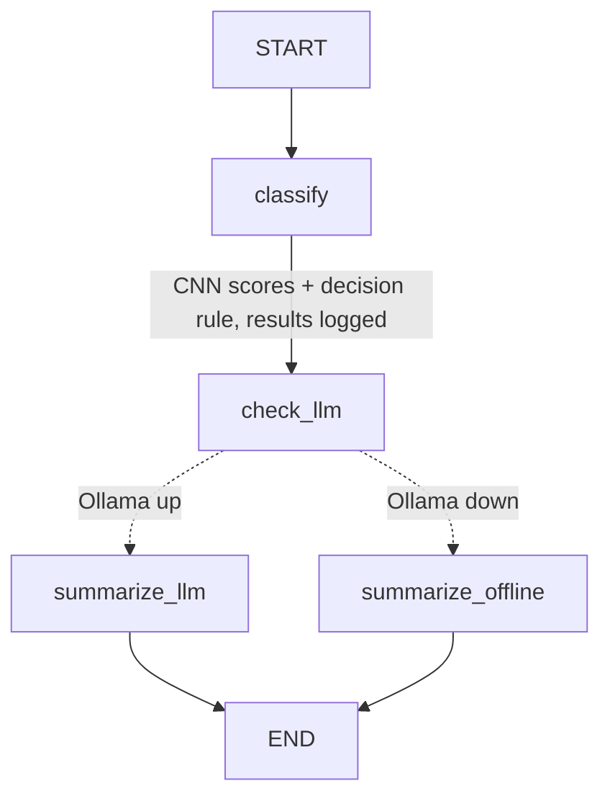
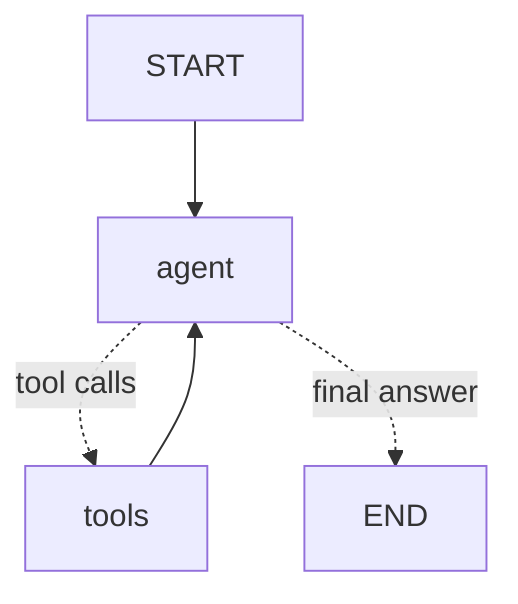

# cv for fraud detection at verizon

classification and fraud detection for sensitive identity documents (telecom-2a), break through tech ai studio, fall 2026, in partnership with verizon.

## team members

| name | github handle | contribution |
|------|---------------|--------------|
| margaret cartee | @margaret-ca | hog/lbp feature extraction, synthetic fraud generation |
| abdullah suleman | @abdullahsulem | data collection, exploratory data analysis, dataset documentation |
| aarav rajeev gupta | @A-Arav0307 | data preprocessing, feature engineering, data validation |

## project overview

verizon onboards wireless and wireline customers with identity documents such as passports, driver's licenses, and national id cards. some of those documents are forged. the goal of this project is to build a binary classifier that looks at an image of an identity document and labels it genuine or fake, so that identity theft can be caught during onboarding.

planned milestones:

1. binary classification of genuine vs fake documents (current)
2. an ai agent that calls the classifier to flag fraud on submitted documents
3. multi-class classification of document type (passport, driver's license, national id)

current focus: a cnn that distinguishes genuine from fake passports (see `deep learning algorithms/`). a classical hog/lbp baseline is included for comparison.

## data

source: the idnet identity document analysis dataset on kaggle (chitreshkr/idnet-identity-document-analysis), a synthetic dataset of about 597,900 identity document images (about 400 gb) covering passports, driver's licenses from 10 u.s. states, and national id cards from 10 european countries. the full archive is not stored in this repository.

local samples in this repository:

- `idnet_sample/` : full-size sampled images, split into `real/` and `fake/`, then by document type (`passport`, `drivers_license`, `national_id`). passports are from the greek (grc) set, about 100 per class.
- `idnet_sample_compressed/` : the same images re-encoded as webp to save disk space.
- `idnet_processed/` : grayscale 256x256 versions of the compressed images.
- `idnet_processed_manifest.csv` : one row per processed image with its path, label, and document type.
- `data/sample/` : a separate local pull made with `scripts/sample_idnet.py` (not committed). it contains genuine passport images from the `positive` folder of the grc archive.

## what has been done so far

- sampled a small subset of the dataset by document type (`image-slice.py`, `config.py`).
- built a streaming sampler that reads images straight from the kaggle download without fetching the whole archive. it can filter by folder (for example `--include /positive/`) and logs the folders it reaches (`scripts/sample_idnet.py`).
- generated synthetic fake documents from the sampled real ones, with two approaches: whole-image degradation using blur, noise, and compression (`generate-fake.py`), and localized tampering using copy-move and splice patches (`generate-fake-localized.py`).
- compressed the samples to webp (`compress.py`).
- preprocessed images to grayscale and 256x256, and wrote a manifest (`preprocess.py`).
- extracted hog and lbp features (`extract-features.py`).
- explored the data (`exploration.ipynb`) and prototyped the sampling and preprocessing steps in colab (`preprocessing_pipeline.ipynb`, with its model-training cells removed).

## model results (grc passports, 75 genuine + 75 real idnet forgeries)

5-fold cross-validation grouped by photo id (a document and its forged copy never straddle the split). full table in `deep learning algorithms/results_table.md`, plots in `roc_curves.png` and `confusion_best.png`.

| model | accuracy | f1 | roc-auc | face-replacement recall |
|---|---|---|---|---|
| resnet50 (best cnn) | 0.953 | 0.952 | 0.980 | 0.76 |
| resnet50, jpeg-reencoded | 0.933 | 0.932 | 0.982 | 0.72 |
| resnet18 | 0.907 | 0.901 | 0.969 | 0.56 |
| efficientnet-b0 | 0.860 | 0.851 | 0.939 | 0.40 |
| hog+lbp random forest | 1.000 | 1.000 | 1.000 | 1.00 |
| hog+lbp svm / logreg | 0.98 / 0.99 | 0.98 / 0.99 | 0.995 / 1.000 | 1.00 / 0.96 |

caveats: only 150 images from one document template, so these numbers are optimistic and noisy. the near-perfect hog/lbp score on a fixed-layout template should not be read as proof the classifier generalizes; it needs more data and other countries before it is trusted. genuine images are png and one forgery type is jpg, so every model was also run with all images re-encoded as jpeg; results barely changed.

## cnn scripts (`deep learning algorithms/`)

- `train_cnn.py` : cross-validated training (`--arch resnet18|resnet50|effnet_b0`, `--reencode 90`), or `--final` to train on all data and save `<name>.pt`
- `baseline_hog_lbp.py` : hog/lbp features with svm, random forest, logistic regression, same split and metrics
- `predict.py` : `ForgeryClassifier("final_r50.pt").predict(path)` returns label and fake probability (entry point for the agent milestone)
- `noise_experiment.py` / `plot_noise.py` : noise comparison above and its heatmap
- `make_report.py` : builds `results_table.md`, `roc_curves.png`, `confusion_best.png`
- the trained weights (`final_r50.pt`, about 90 mb) are not committed; recreate with `python train_cnn.py --arch resnet50 --final --name final_r50`

## noise comparison (300 genuine passports)

`idnet_sample/` now holds 300 genuine passports and 300 fakes made by `generate-fake.py` (blur, noise, compression, dropout). `deep learning algorithms/noise_experiment.py` builds extra fakes by adding gaussian, poisson, or salt-and-pepper noise to the same genuine passports, each at a mild and a moderate level. A resnet18 (402x568 input, 8 epochs) is trained on one fake type and tested on all of them, with 5-fold cross-validation split by passport. rows = training fakes, columns = test fakes. heatmap: `deep learning algorithms/noise_heatmap.png`.

accuracy:

| train \ test | gauss mild | gauss mod | poisson mild | poisson mod | s&p mild | s&p mod | generate_fake |
|---|---|---|---|---|---|---|---|
| gaussian (mod) | 0.500 | 1.000 | 0.500 | 1.000 | 0.500 | 1.000 | 0.500 |
| poisson (mod) | 0.500 | 1.000 | 0.500 | 1.000 | 0.500 | 1.000 | 0.500 |
| salt & pepper (mod) | 0.500 | 0.500 | 0.500 | 0.542 | 0.500 | 1.000 | 0.500 |
| generate_fake | 1.000 | 1.000 | 1.000 | 1.000 | 1.000 | 1.000 | 0.945 |

roc-auc:

| train \ test | gauss mild | gauss mod | poisson mild | poisson mod | s&p mild | s&p mod | generate_fake |
|---|---|---|---|---|---|---|---|
| gaussian (mod) | 1.000 | 1.000 | 1.000 | 1.000 | 1.000 | 1.000 | 0.617 |
| poisson (mod) | 1.000 | 1.000 | 1.000 | 1.000 | 1.000 | 1.000 | 0.604 |
| salt & pepper (mod) | 0.943 | 1.000 | 0.985 | 1.000 | 1.000 | 1.000 | 0.555 |
| generate_fake | 1.000 | 1.000 | 1.000 | 1.000 | 1.000 | 1.000 | 0.994 |

takeaways:

- a model trained on one moderate noise type detects the other moderate noise types perfectly, so gaussian, poisson, and salt-and-pepper are easy for the cnn to tell apart from a clean passport.
- accuracy of 0.500 with roc-auc near 1.0 on the mild columns means the model ranks noisy images above clean ones but its scores fall under the 0.5 cutoff. the threshold would need recalibrating for mild noise.
- none of the noise-trained models transfer to the `generate_fake` fakes (auc 0.55-0.62), which are blur and compression based.
- training on `generate_fake` generalizes to every noise type (accuracy 1.0) and reaches 0.945 accuracy / 0.994 auc on its own fakes, so it is the most robust training set.
- caveat: these are all synthetic degradations of a clean image, which is much easier than the real idnet forgeries above. high scores here do not mean forged documents will be caught.

## fraud detection agent (`agent/`)

an automatic pipeline: upload or point at document images, the cnn (`deep learning algorithms/final_r50.pt`) scores each one, a policy turns the score into approve / manual review / reject, every result is logged, and a local ollama model writes a short explanation and answers questions about past scans. the cnn makes the decision; the llm never overrides it.

- `agent/tools.py` : tools (classify one document, scan a folder, scan history summary, model report). paths are restricted to the repo and `agent/uploads/`. policy: approve below 0.2 fake probability, reject above 0.8, otherwise manual review.
- `agent/pipeline.py` : runs the team's data/model pipeline (`generate-fake-2B.py` → `preprocess.py` → `extract-features-2B.py` → `train-classifier.py`) in an isolated workspace under `agent/workspaces/`, so the shared `idnet_*` folders and csvs are never overwritten. genuine images must come from a `positive` folder (the generator refuses sources it cannot verify as genuine). the agent calls it with one tool, `run_data_pipeline`; a 75-image run takes about 40 seconds.
- `agent/classical.py` : trains every classical model defined in the team's `train-classifier.py` (extra trees, random forest, xgboost, lightgbm, decision tree, adaboost, naive bayes, logistic regression, linear and rbf svm, knn, mlp) on a pipeline run's features, saves them to `agent/models/classical/` (not committed), and scores any image with all of them using the 295 `extract-features-2B.py` team features. it runs in a subprocess because pytorch and xgboost/lightgbm crash if loaded into one process on macos.
- `agent/agent.py` : the agent, built with langgraph and langchain-ollama (`ChatOllama`). two graphs, shown below. the cnn always makes the decision; ollama only explains and answers questions.
- `agent/app.py` : streamlit ui with tabs for uploading documents (scored by the cnn and, optionally, all 12 classical models), scanning a folder, running the data pipeline, training and comparing models, asking the agent, and history.
- `agent/test_agent.py` : smoke tests (decisions, bad input, path restriction, tool-calling loop against a fake ollama server, ui render).

agent graphs (print them with `python -m agent.agent graph`):





the first graph is the document pipeline (a conditional edge picks the ollama or the offline summary, so it works without ollama). the second is the chat agent: the llm chooses tools from `agent/tools.py`, they run as plain python, and the loop stops after 5 rounds.

why ollama: it runs the llm locally, so identity document data never goes to an outside service. it is only used to explain results and answer questions, not to detect fraud.

run it:

```
brew install ollama libomp && ollama serve  # separate terminal (libomp is needed by xgboost on macos)
ollama pull llama3.1:8b                     # or set OLLAMA_MODEL to another tool-calling model
pip install -r requirements.txt
python train_cnn.py --arch resnet50 --final --name final_r50   # from "deep learning algorithms/", creates the weights
streamlit run agent/app.py                  # from the repo root
python agent/test_agent.py                  # smoke tests
```

the classical models learn the pipeline's synthetic tampering (rotation, partial blur, copy-move, splice, text edits), while the cnn learned idnet's real forgeries, so they disagree: in a 15-image demo the classical models flagged the team's synthetic fakes (11-12 of 12 models) but mostly missed real idnet forgeries (2-4 of 12), and the cnn did the opposite. their held-out scores (30 images) are not comparable to the cnn's cross-validation numbers.

limits: a small local model (llama3.1:8b) was unreliable at multi-step tool use, so the pipeline is exposed as a single one-call tool. the classifier was trained on 75 genuine and 75 forged greek passports, so other document types or countries are out of scope and the ui warns when an image is not 1136x803. the smoke tests use a fake ollama server, so they check the plumbing, not the quality of a real llm.

## repository layout

- `config.py` : shared paths and constants
- `image-slice.py`, `generate-fake.py`, `generate-fake-localized.py`, `compress.py`, `preprocess.py`, `extract-features.py` : data pipeline, run in that order
- `scripts/sample_idnet.py` : streaming sampler for the kaggle archive
- `exploration.ipynb`, `preprocessing_pipeline.ipynb` : notebooks
- `requirements.txt` : python dependencies

## setup

```
git clone https://github.com/Break-Through-Tech/Telecom-2A-classification-and-fraud-detection-for-sensitive-documents.git
cd Telecom-2A-classification-and-fraud-detection-for-sensitive-documents
pip install -r requirements.txt
```

to pull a sample straight from kaggle, put your kaggle access token at `~/.kaggle/access_token`, install `stream-unzip`, then run for example:

```
python scripts/sample_idnet.py --include /positive/ --max-images 75 --per-folder 75 --max-download-mb 8000
```

the genuine images in the grc archive start about 5 gb into the download.

## next steps

- get more forged passports and other countries/document types, then re-check the cnn and baseline.
- improve face-replacement detection (the weakest forgery type).
- build the ai agent that calls `predict.py`.
- later milestones: the ai agent, then multi-class document type classification.
